# Architecture

govctl stores governance in the repository and provides the CLI that validates,
changes and presents it. People and agent clients use the same contracts. Agent
runtime selection, credentials, authentication and scheduling belong to external
clients; govctl does not require a particular orchestration product.

The diagram separates the implemented local system from the proposed shared
publication protocol. Solid blue nodes are implemented governance components;
green is local coordination; dashed amber nodes are **draft design, not available
commands**.

[Open the full-size diagram](diagrams/architecture.svg) ·
[Mermaid source](diagrams/architecture.mmd)

## Implemented architecture

The CLI reads authoritative files under `gov/`. A mutation passes the relevant
schema, reference, lifecycle and local write-safety checks before changing those
files. RFCs define obligations, ADRs explain decisions, and Work Items track
execution. RFC Clauses remain separately addressable resources within an RFC.
These three business entities are the targets of collaboration; they are not the
only artifact types in govctl.

Verification Guards and Conformance Cases support validation. Guards define
executable checks used by applicable completion gates. Conformance Cases connect
scenarios to versioned requirements and reusable Guards; a mapping does not itself
execute a test. `check` validates governance structure and consistency, while the
relevant verification commands run executable checks.

Authors, contributions, comments and review conclusions are attached to RFCs, ADRs
and Work Items. Native collaboration records are append-only and bind their
targets to an exact source revision. Their projections distinguish current,
stale, resolved and unverified conclusions. A review approval does not advance an
artifact's lifecycle by itself. Actor metadata records a contributor; a declared
name or model footprint is not authentication or proof of reviewer independence.
See [Authors, Comments, and Reviews](collaboration.md) for the current CLI and trust
contract.

Readers derive status, JSON responses, rendered Markdown and the read-only TUI
from this source. Generated RFC, ADR and Work Item pages are projections, not an
additional authority. The hand-authored guide explains the contracts; the RFCs
define them.

### Local coordination has a clone boundary

The current coordination mechanisms solve local problems:

| Mechanism                          | Scope and purpose                                                                                                                                                                 |
| ---------------------------------- | --------------------------------------------------------------------------------------------------------------------------------------------------------------------------------- |
| Governance write lock              | Serializes supported mutations of the same local governance root.                                                                                                                 |
| RFC claims and ID reservations     | Coordinate workspaces sharing one Git or jj repository store. RFC claims cover the version-sensitive operations defined by RFC-0010; they are not universal artifact write locks. |
| Work Item presence                 | Reports activity in other workspaces of that clone; it is advisory.                                                                                                               |
| Workspace loops and round evidence | Record local execution and verification progress for Work Items; they do not run a distributed agent scheduler.                                                                   |

Independent clones do not share these registries. A local claim is not a remote
execution grant, and an assignment or execution receipt in collaboration history
is not an exclusive distributed claim. Existing standalone commands remain useful
without a shared publication service. See [Parallel Workspaces](parallel-workspaces.md),
[RFC-0004](../rfc/RFC-0004.md), [RFC-0006](../rfc/RFC-0006.md) and
[RFC-0010](../rfc/RFC-0010.md).

## Draft: repository-authoritative collaboration

[RFC-0012](../rfc/RFC-0012.md) is **draft / spec**. The following design explains
its proposed guarantees; it does not describe implemented CLI commands or a
finalized wire format.

The configured canonical repository's `main` becomes the shared authority for
requests and execution ownership. Each clone can reconstruct accepted state from
the same history and explicit policy context. A local event or an unmerged pull
request grants no execution rights. The publication point is the conditional
fast-forward of canonical `main`, validated against the exact parent being
advanced. A protected branch may use a pull request or merge queue, but its final
update must apply the same validation.

### Attached requests, two kinds of exclusivity

A request describes an operation on one existing RFC, ADR or Work Item at an exact
input revision. Request, claim, handoff and result records remain attached to that
entity. Their projected states do not create a fourth governed task artifact or
replace the entity's lifecycle. A cancelled review request, for example, does
not cancel its RFC.

Each request has at most one current execution holder. A modifying request also
needs exclusive write ownership of every existing artifact it will change.
Different review requests may examine the same immutable revision concurrently;
they own their individual requests, not the reviewed artifact's write scope.
Creation of a new artifact still needs a unique accepted identity.

A request's operation and input are fixed. Changed requirements or a newer input
need a new request identity. Completed and cancelled requests are terminal;
retrying a completed operation returns its recorded outcome instead of starting
another execution. This permits many collaboration patterns without prescribing
one RFC-to-ADR-to-Work-Item workflow. A client can request a review, an amendment,
an ADR based on an agreed RFC, implementation against a Work Item, or a lifecycle
transition, subject to the relevant governance rules.

### Publication and retries

An external client proposes a request or claim against the observed authoritative
parent. The publication validator checks authorization, current input, existing
ownership and the operation's identity. Execution rights take effect only when
that proposal is accepted on `main`. The agent can then execute locally and
propose a result against its current claim generations.

Two clones claiming the same request from the same parent cannot both win. After
the first publication, the other must fetch the new authority and revalidate its
intent. Textual rebasing alone cannot make an obsolete claim valid. The same rule
applies when separate modifying requests compete for one artifact's write scope.

Every operation carries a stable identity. If the server accepted a publication
but its response was lost, retrying the same semantic operation returns the
accepted receipt. Reusing its identity with different content is an error. A
retry may update its publication-parent witness, but cannot silently substitute a
new actor, input, holder or result. This makes effects idempotent; it does not
guarantee that an external process physically runs only once.

### Handoff, takeover and late results

Request ownership and artifact write ownership each have increasing generations.
An explicit handoff or authorized takeover names the old generations and the new
holder. Once accepted, the previous holder can no longer publish an effective
result for those scopes. Completion, cancellation and release invalidate the
affected claims. A process may continue running after losing a claim, but its
late output cannot change an artifact or finish the current request.

The first version deliberately uses explicit transfer. Elapsed time, a missing
heartbeat or an unreachable machine does not automatically revoke or transfer
authority. The existing clone-local claim expiry rules remain separate. The
external policy identifies who may authorize takeover and why.

### Results bind to work, not incidental coordination commits

The proposed protocol distinguishes these identities:

| Binding                                     | Meaning                                                                              |
| ------------------------------------------- | ------------------------------------------------------------------------------------ |
| Request and operation identities            | Which fixed task is being performed, and which logical update is being retried.      |
| Authoritative publication parent            | The `main` state used to validate a proposed coordination update.                    |
| Input artifact revision                     | The exact RFC, ADR or Work Item content used by the operation.                       |
| Claim generations and holder                | The current request and write-scope authority that permits an effective result.      |
| Immutable code commit                       | The code revision reviewed, when a request includes code review.                     |
| Outcome or resulting revision               | The durable conclusion or output of the operation.                                   |
| Authorization authority and policy revision | The external decision context used to permit the operation, without its credentials. |

A code-review target is an explicit immutable commit, separate from the current
coordination `main` HEAD. Publishing another claim or comment on `main` therefore
does not stale a review of unchanged document and code targets. A changed target
does stale it; a later client cannot reinterpret the old conclusion as approval
of the new target. Obsolete results may remain as explicitly ineffective history.
Stale input does not prevent cancellation or release of its request.

### Authorization and compatibility

External authorities authenticate participants, bind signers to subjects and
decide permissions. govctl validates protocol structure, revision bindings and
causal state using that explicit context. A key stored in the repository, a role
label or permission to push Git commits is insufficient by itself to authorize an
agent's action or make its approval independent. Scheduling and credentials stay
outside the repository's collaboration records.

Publication mode needs a new advertised capability. It will not silently fall
back to clone-local coordination. Existing collaboration format versions 1 and 2
retain their bytes, identities and standalone interpretation under
[RFC-0011](../rfc/RFC-0011.md). Old assignments and receipts are not promoted to
ownership, and old reviews are not rebound to the new code-target semantics.

The draft leaves exact commands, record encoding and error identifiers for the
next specification stage. It also leaves hosting and authentication adapters to
external integrations. Any eventual implementation must preserve the existing
lifecycle and verification gates; a valid claim or successful publication is not
permission to skip them.
